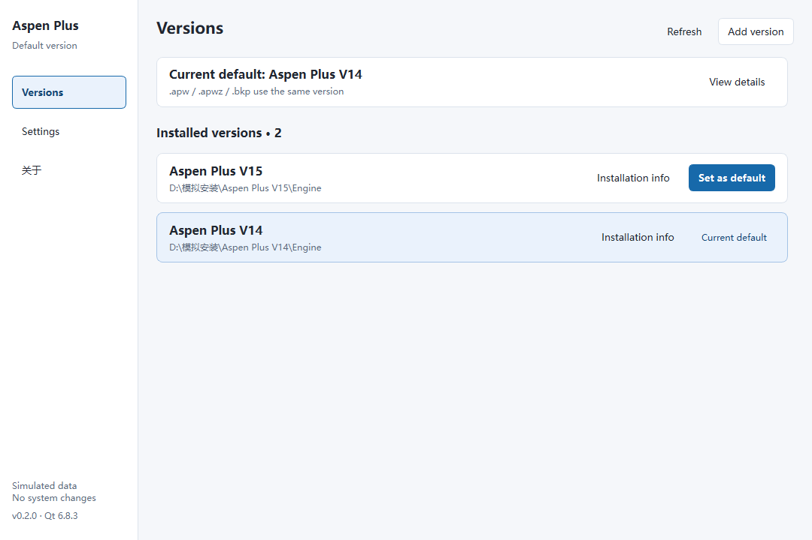

<p align="center">
  
</p>

# AspenVersionManager

English | [简体中文](readme/readme_CN.md)

A tool for switching the default version used to open Aspen Plus model files.

When multiple versions of Aspen Plus are installed on the same computer, model files may open in the wrong version. AspenVersionManager shows the current file associations and lets you switch the default executable to the version you want to use.
This applies to opening model files by double-clicking them or from external programs that use Windows file associations.

Currently supports Aspen Plus only, for `.apw`, `.apwz`, and `.bkp` files.



## Features

- Scan installed versions and manually add installations that were not detected.
- View current file associations, open commands, and executable paths.
- Switch the default version used to open model files.
- Automatically back up association settings and restore them from a backup.

## Usage

1. Start the application and view installed versions and current associations on the “Versions” page.
2. If the version you need is missing, click “Add version” and select its installation directory or executable.
3. Click “Set as default” for the target version and wait for the result.
4. To restore the previous configuration, open “Settings”, click “Restore configuration”, and select a backup.

Changing system-wide associations usually requires administrator privileges. If access is denied, run the application as administrator. Files that are not yet associated with Aspen Plus must first be associated through Windows Default Apps.

If external code specifies an Aspen executable path directly or creates Aspen objects through COM/ActiveX, check that code and the corresponding registration settings separately. Switching file associations does not guarantee a change to the version launched by those calls.

## How It Works

The application updates the open command in an existing file association to point to the selected Aspen Plus executable.

Windows stores per-user and system-wide association information in the following locations. HKEY_CLASSES_ROOT provides a merged view of both:

```text
HKEY_CURRENT_USER\Software\Classes
HKEY_LOCAL_MACHINE\Software\Classes
```

Before switching versions, the application queries Windows for the active ProgID, open command, and executable path, and resolves any CurVer redirection. Once the command source has been confirmed, it updates whichever of the following locations is currently in effect:

```text
HKEY_CURRENT_USER\Software\Classes\<file-type-id>\shell\open\command
```

or:

```text
HKEY_LOCAL_MACHINE\Software\Classes\<file-type-id>\shell\open\command
```

The value being updated is the default value of the `command` key. For example, this command points to V11:

```text
"D:\Aspen Plus V11\Engine\apwn.exe" "%1"
```

After switching to V14, it becomes:

```text
"D:\Aspen Plus V14\Engine\apwn.exe" "%1"
```

These paths only illustrate the command format. When applying a change, the application verifies the target executable's identity and preserves the command arguments. If a command for the target version and file type has been discovered, its arguments are used instead.

The application also reads extension-to-ProgID mappings, CurVer redirections, and the ProgId and Hash values under the following location to check for association changes:

```text
HKEY_CURRENT_USER\Software\Microsoft\Windows\CurrentVersion\Explorer\FileExts\<extension>\UserChoice
```

These queried entries are left unchanged. The application only writes existing open commands. It does not create new associations or modify UserChoice, extension-to-ProgID mappings, or COM registration settings. Associations that use special opening mechanisms such as DDE or COM, and commands whose source cannot be confirmed, are rejected.

A backup is saved before any write. After writing, the application notifies Windows of the association change and queries the effective result again. If the operation fails, it attempts to roll back. Restoration also checks the current configuration and stops if external changes are detected.

## Build Environment

- Platform: Windows x64
- Language: C++17
- UI: Qt Widgets
- Qt: 6.8.3
- Build system: CMake 3.19 or later

The local MSVC build uses Visual Studio Community 2026, MSVC 19.51.36260, and the Qt 6.8.3 `msvc2022_64` kit.

The MinGW build uses MinGW-w64 GCC 13.1.0 and the Qt 6.8.3 `mingw_64` kit.

## License

This project is licensed under the MIT License. See [LICENSE](LICENSE). Third-party licenses are included in the [licenses](licenses) directory distributed with the application.

**AspenVersionManager is an independent tool and is not an official AspenTech product.**

The English version was translated by AI.
