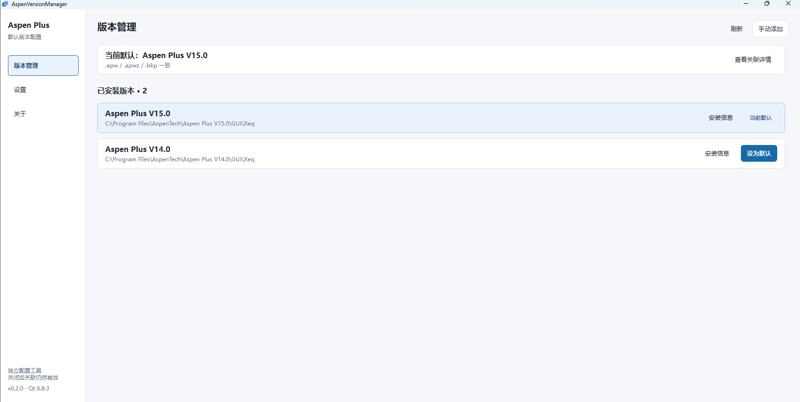

<p align="center">
  
</p>

# AspenVersionManager

[English](../README.md) | 简体中文

Aspen 版本管理器，用于切换 Aspen Plus 模型文件的默认打开版本。

电脑同时安装多个 Aspen Plus 版本时，模型文件可能由错误的版本打开。AspenVersionManager 可以查看当前文件关联，并将默认打开程序切换到指定版本。
适用于双击模型文件，以及外部程序通过 Windows 文件关联打开模型的情况。

目前仅支持 Aspen Plus 的 `.apw`、`.apwz` 和 `.bkp` 文件。



## 功能

- 扫描已安装版本；未被识别的安装可手动添加。
- 查看当前关联、打开命令和程序路径。
- 切换模型文件的默认打开版本。
- 自动备份关联配置，支持从备份恢复。

## 使用

1. 启动程序，在“版本管理”中查看已安装版本及当前关联。
2. 如果列表中没有需要的版本，点击“手动添加”，选择安装目录或可执行文件。
3. 选择目标版本并执行切换，等待操作结果。
4. 恢复原有配置时，进入“设置”，点击“恢复配置”并选择备份。

系统级关联的修改通常需要管理员权限，出现访问拒绝时可用管理员身份重新运行。尚未关联 Aspen Plus 的文件，需要先在 Windows 默认应用中完成关联。

外部代码若直接指定 Aspen 可执行文件路径，或通过 COM/ActiveX 创建 Aspen 对象，仍需检查代码及对应注册配置。文件关联的切换不保证改变这些调用的启动版本。

## 修改原理

程序修改已有文件关联中的打开命令，使其指向所选 Aspen Plus 程序。

Windows 用户级和系统级关联信息分别保存在以下位置，HKEY_CLASSES_ROOT 提供它们的合并视图：

```text
HKEY_CURRENT_USER\Software\Classes
HKEY_LOCAL_MACHINE\Software\Classes
```

切换前，程序查询 Windows 返回的 ProgID、打开命令和可执行文件路径，并解析可能存在的 CurVer 重定向。确认命令来源后，修改以下路径中实际生效的一项：

```text
HKEY_CURRENT_USER\Software\Classes\文件类型标识\shell\open\command
```

或：

```text
HKEY_LOCAL_MACHINE\Software\Classes\文件类型标识\shell\open\command
```

修改对象是 `command` 键的默认值。例如，下列命令指向 V11：

```text
"D:\Aspen Plus V11\Engine\apwn.exe" "%1"
```

切换到 V14 后，命令变为：

```text
"D:\Aspen Plus V14\Engine\apwn.exe" "%1"
```

以上路径仅用于说明命令形式。实际修改会验证目标程序身份，并保留命令参数；已发现目标版本对应的文件类型命令时，使用该命令的参数。

程序还会读取扩展名与 ProgID 的映射、CurVer 重定向，以及以下位置中的 ProgId 和 Hash，用于检查关联变化：

```text
HKEY_CURRENT_USER\Software\Microsoft\Windows\CurrentVersion\Explorer\FileExts\<扩展名>\UserChoice
```

这些查询项保持原值。程序只写入已有的打开命令，不新建关联，也不修改 UserChoice、扩展名对应的 ProgID 或 COM 注册信息。含 DDE、COM 等特殊打开机制的关联，或来源无法确认的命令，会被拒绝修改。

备份在写入前保存。写入完成后，程序通知 Windows 更新关联，再查询实际生效结果；失败时尝试回滚。恢复也会检查当前配置，发现外部改动后停止覆盖。

## 编译环境

- 平台：Windows x64
- 语言：C++17
- 界面：Qt Widgets
- Qt：6.8.3
- 构建系统：CMake 3.19 或更高版本

本机 MSVC 构建使用 Visual Studio Community 2026、MSVC 19.51.36260，以及 Qt 6.8.3 的 `msvc2022_64` 套件。

MinGW 构建使用 MinGW-w64 GCC 13.1.0，以及 Qt 6.8.3 的 `mingw_64` 套件。

## 许可证

本项目采用 MIT 许可证，详见 [LICENSE](../LICENSE)。第三方许可证随程序保存在 [licenses](../licenses) 目录。

**AspenVersionManager 是独立工具，非 AspenTech 官方产品。**
